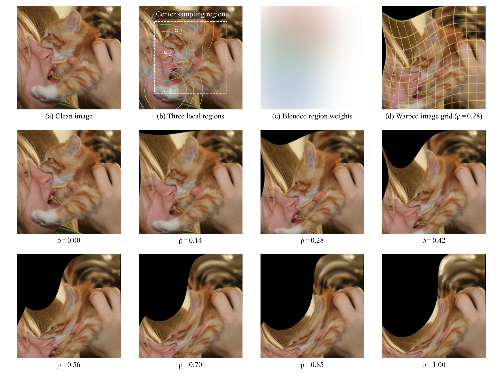

# ICLA-CA

## Improving Adversarial Transferability in Vision-Language Models through Controlled Deformation

## Overview

How much should an image be deformed when constructing transferable adversarial examples? Stronger deformation can reduce differences between surrogate and target models, but it can also weaken the attack on the surrogate. Our study examines this balance through adversarial retrieval margins and identifies a sufficient condition for transferring a top-1 retrieval error: the surrogate margin must exceed the absolute difference between the surrogate and target margins.

We introduce **Intensity-Controlled Local Affine Warping (ICLAW)**, which blends local affine motions into a smooth displacement field and normalizes its root-mean-square magnitude. This makes deformation intensity an explicit, adjustable parameter. **ICLA-CA** combines these transformed views with trajectory mixing and alternating image–text contrastive optimization.

The experiments evaluate transfer across ALBEF, TCL, and two CLIP architectures on image–text retrieval. Additional evaluations examine transfer to image captioning, visual grounding, and large vision–language models, as well as the use of ICLAW within existing attacks.

*Visualization of ICLAW at different deformation intensities.*

## Flickr30K Results

The following tables reproduce Table 1 of the paper. Adversarial examples are generated using the indicated source model with an image perturbation budget of **8/255** and at most **one word substitution per caption**.

Each cell reports **TR / IR attack success rate at R@1 (%)**. TR denotes image-to-text retrieval; IR denotes text-to-image retrieval. The Average column is the mean over the three black-box targets, excluding the source model. Higher values indicate stronger attacks.

### Source: ALBEF

| Attack | ALBEF | TCL | CLIP ViT | CLIP CNN | Average |
| --- | --- | --- | --- | --- | --- |
| PGD | 93.74 / 94.43 | 24.03 / 27.90 | 10.67 / 15.82 | 14.05 / 19.11 | 16.25 / 20.94 |
| SGA | 99.90 / 99.93 | 87.88 / 88.05 | 36.69 / 46.78 | 39.59 / 49.78 | 54.72 / 61.54 |
| DRA | 99.90 / 99.93 | 91.57 / 91.36 | 46.26 / 56.80 | 49.55 / 59.01 | 62.46 / 69.06 |
| SA-AET | 99.90 / 99.98 | 96.42 / 96.02 | 55.58 / 63.89 | 57.22 / 65.59 | 69.74 / 75.17 |
| HQA-VLAttack | 100.00 / 100.00 | 97.58 / 96.45 | 52.64 / 63.92 | 57.22 / 67.34 | 69.15 / 75.90 |
| SADCA | 100.00 / 100.00 | 98.52 / 97.83 | 81.10 / 82.83 | 85.44 / 86.11 | 88.35 / 88.92 |
| ICLA-CA (ours) | 100.00 / 99.98 | 99.16 / 99.19 | 96.56 / 96.07 | 95.40 / 95.95 | 97.04 / 97.07 |

### Source: TCL

| Attack | ALBEF | TCL | CLIP ViT | CLIP CNN | Average |
| --- | --- | --- | --- | --- | --- |
| PGD | 35.77 / 41.67 | 99.37 / 99.33 | 10.18 / 16.30 | 14.81 / 21.10 | 20.25 / 26.36 |
| SGA | 92.40 / 92.77 | 100.00 / 100.00 | 36.81 / 46.97 | 41.89 / 51.53 | 57.03 / 63.76 |
| DRA | 95.20 / 95.58 | 100.00 / 100.00 | 47.24 / 57.28 | 52.23 / 62.23 | 64.89 / 71.70 |
| SA-AET | 98.85 / 98.50 | 100.00 / 100.00 | 56.20 / 63.47 | 59.77 / 67.86 | 71.61 / 76.61 |
| HQA-VLAttack | 97.29 / 97.54 | 100.00 / 100.00 | 56.20 / 64.98 | 61.17 / 69.91 | 71.55 / 77.48 |
| SADCA | 99.58 / 99.56 | 100.00 / 100.00 | 78.28 / 83.18 | 86.46 / 88.71 | 88.11 / 90.48 |
| ICLA-CA (ours) | 98.85 / 99.04 | 100.00 / 100.00 | 94.85 / 95.04 | 95.66 / 95.33 | 96.45 / 96.47 |

### Source: CLIP ViT

| Attack | ALBEF | TCL | CLIP ViT | CLIP CNN | Average |
| --- | --- | --- | --- | --- | --- |
| PGD | 3.13 / 6.48 | 4.43 / 8.83 | 69.33 / 84.79 | 13.03 / 17.43 | 6.86 / 10.91 |
| SGA | 22.42 / 34.59 | 25.08 / 36.45 | 100.00 / 100.00 | 53.26 / 61.10 | 33.59 / 44.05 |
| DRA | 27.84 / 42.84 | 27.82 / 44.60 | 100.00 / 100.00 | 64.88 / 69.50 | 40.18 / 52.31 |
| SA-AET | 36.60 / 50.44 | 39.20 / 51.10 | 100.00 / 100.00 | 71.01 / 74.10 | 48.94 / 58.55 |
| HQA-VLAttack | 44.94 / 58.37 | 46.58 / 60.05 | 100.00 / 100.00 | 87.48 / 89.43 | 59.67 / 69.28 |
| SADCA | 87.07 / 89.20 | 87.04 / 87.98 | 100.00 / 100.00 | 97.90 / 97.46 | 90.67 / 91.55 |
| ICLA-CA (ours) | 91.14 / 92.31 | 92.41 / 91.90 | 100.00 / 100.00 | 97.19 / 97.70 | 93.58 / 93.97 |

### Source: CLIP CNN

| Attack | ALBEF | TCL | CLIP ViT | CLIP CNN | Average |
| --- | --- | --- | --- | --- | --- |
| PGD | 2.29 / 6.15 | 4.53 / 8.88 | 5.40 / 12.08 | 89.78 / 93.04 | 4.07 / 9.04 |
| SGA | 15.64 / 28.06 | 18.02 / 33.07 | 39.92 / 51.45 | 99.87 / 99.90 | 24.53 / 37.53 |
| DRA | 19.50 / 34.59 | 21.60 / 37.88 | 48.47 / 59.12 | 99.87 / 99.90 | 29.86 / 43.86 |
| SA-AET | 23.98 / 38.28 | 27.29 / 41.81 | 54.11 / 64.21 | 100.00 / 99.97 | 35.13 / 48.10 |
| HQA-VLAttack | 29.41 / 45.98 | 31.51 / 50.00 | 72.15 / 78.83 | 100.00 / 99.97 | 44.36 / 58.27 |
| SADCA | 49.43 / 60.55 | 55.53 / 63.19 | 77.18 / 79.57 | 100.00 / 100.00 | 60.71 / 67.77 |
| ICLA-CA (ours) | 75.29 / 78.88 | 75.13 / 81.33 | 93.99 / 93.46 | 100.00 / 100.00 | 81.47 / 84.56 |

ICLA-CA achieves the highest black-box average in both retrieval directions for all four source models in this comparison. With CLIP CNN as the source, its average TR/IR ASR is 81.47%/84.56%, compared with 60.71%/67.77% for SADCA.

## Acknowledgments

Our implementation builds on SADCA and uses model implementations from OpenAI CLIP, ALBEF, and BERT/Transformers.
